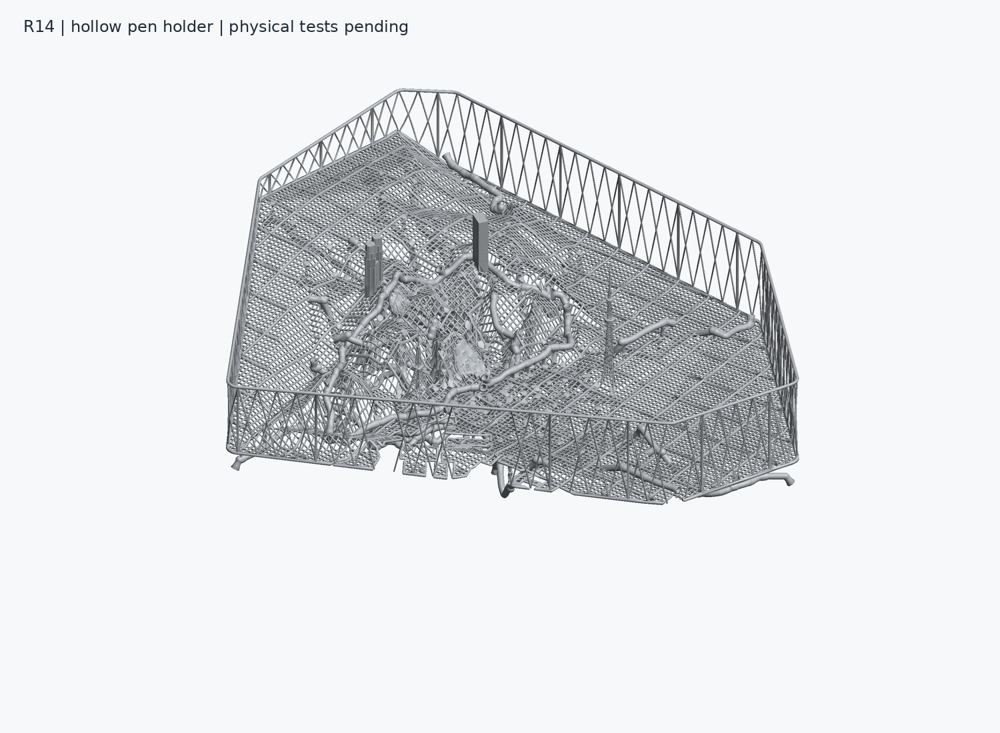

# R14 修正モデルと数値検証

R14の回収・形状修正と保存後の数値検証を完了しました。最終本体は一つの閉じた境界で構成され、全三角形の厳密検査で不正な交差、接触、共面重複、退化面は0件です。14路線の流路連結、69個の開口、保存STL上の通過、壁厚の領域別測定を個別に確認しています。**実際のSLA造形、支持材の適合、洗浄・硬化、漏れ、顔料通液は未検証であり、印刷合格は付与していません。**

作業先は既存の `recovery/r14-20261109` ブランチと指定されたR14 Driveです。完成済みR13、main、既存の設計用ファイルは変更していません。元の生成コード18ファイルは `recovered_source/` に保持し、現在使用するコードはリポジトリ直下の `penholder_r14/` に保存しています。

## 最終成果物

| 成果物 | 内容 |
|---|---|
| `models/subway_R14_hollow_print.stl` | 一体本体。1,743,478面、230.635460 × 199.689003 × 74.234726 mmです。 |
| `models/subway_R14_hollow_print.3mf` | 同じ頂点座標と向き付き三角形集合を持ち、単位をmmとして保存しています。 |
| `models/rail_R14_L01.stl` から `rail_R14_L14.stl` | 14路線の個別部品です。L11とL13の各1個の独立した装飾マーカーは継承しており、本体では基準形状に接続します。 |
| `models/flow_coupon_R14.stl` | 元のバイト列を保持した5流路・10開口の試験片です。 |
| `previews/` | 実際の保存形状から作成した本体、路線、試験片とL12の局所断面です。 |
| `reports/` | 最終ファイルのSHA256と結び付いた数値検証、再生成記録、保存対応表を収録しています。 |
| `archives/` | 本体の完全復元用ZIPと、入力・基準GLB・補修データ・中間形状を含む再生成入力ZIPです。GitHubでは分割して保存します。 |

最終本体STLのSHA256は `8f0484bf167c83327a2a3b7a7606c7da04b81e7e337642dd2bb626a15deb2b47`、3MFは `cd50c52fff6f4d59e8a4de426a424d90ee29025c7bc8e486608369461ef81cfb` です。STL自体には単位がないため、mmとして読み込んでください。`print` は保存された造形用座標を示し、実機での合格を意味しません。



## 回収結果

元の `SHA256SUMS` は50項目すべてを照合し、50件一致、不一致0件となりました。初期の未回収9項目のうち8項目は総合検証記録のdocumentsから元のバイト列を復元し、残るソース一覧はDriveから直接取得しています。元の `FILE_INVENTORY` も38項目すべてを回収・照合しました。これは旧記録の回収証明であり、新しい形状検証とは区別しています。

生成コード原本の保存コミットは [b60b5a7](https://github.com/ryo100794/tokyo-stl-models/commit/b60b5a795810125ce72772c0e87b7bc9f0005e04)、回収監査は [e67a218](https://github.com/ryo100794/tokyo-stl-models/commit/e67a2183d829d66694d341bce5756d023a2b9ebc) です。[a8cba45](https://github.com/ryo100794/tokyo-stl-models/commit/a8cba45a4b0d66e1ea9a5e008c947d4810898493) は途中保存であり、この最終本体を含みません。旧不良候補は履歴として保持し、修正モデルの代わりには使用していません。

## 修正内容

経路とポートの座標を維持し、管の生成を同じ向きの凸多面体を区間ごとに掃引する方式へ変更しました。公称外径は2.4 mm、内径は1.2 mm、半径方向の差は0.6 mmです。全流路を形状から再度差し引き、基準形状や駅の支持部が流路を塞ぐことを防いでいます。

L07、L09、L12、L13、L14の合流部では、外形を維持したまま同一路線の内腔側にある鋭い突起を局所的に丸めました。追加する内腔は外形を内側へ0.52 mm侵食した領域内に制限し、全路線の組合せで離隔を再検査しています。L09、L13、L14の丸い自由端を斜めに横切る短い弦は、平行壁の垂直な厚さと区別し、その面法線による診断を記録しています。

一体本体では、基準形状の交差と接触を局所的な材料追加で修正し、離れていた海岸線の一部を直径0.7 mmの接続材でつなぎました。内部に重複していた402個の副境界は、全頂点の包含、主境界との厳密な交差・接触検査、意図した14流路からの分離を確認してから除去しています。保存時の4組の数値的な継ぎ目は、座標が完全に一致する対象指定により補正し、最大移動量を0.000001908 mmに限定しました。

## 検証結果

| 項目 | 結果と範囲 |
|---|---|
| 全16 STLの位相・面向き | 境界辺、3面以上が接続する辺、不正な頂点接続、向きの不一致、重複面、退化面は0件です。 |
| 全16 STLの自己交差 | すべての三角形を対象に、厳密な整数・有理数の述語で異常0件です。本体では25,382,504組の重なる三角形包囲箱を検査しました。 |
| 本体の境界 | 一つの連結した閉境界です。個別部品の閉面だけで本体を合格にしていません。 |
| 意図した流路 | 14路線はそれぞれ一つの流路で、69ポートの入口と口元が対応する流路内にあります。全91組の異なる路線の流路間隔は最小0.617153793 mmです。 |
| 保存本体の通過と開口 | 51,030本の経路検査線が通過し、69開口の内部・外部アクセスと口面を確認しています。経路検査には中心線と半径0.55 mmの8方向オフセットを使用します。 |
| 通常外壁 | 14路線の34,976方向を測定し、法線方向の最小値は0.586238064 mmです。0.5 mm未満と境界欠落は0件ですが、分類が曖昧な36区間を保持しています。 |
| 本体の69ポート周辺 | 62,928方向を測定し、外壁法線の最小値は0.552072056 mm、異なる路線の間の法線方向の壁は最小0.632362025 mmです。0.5 mm未満、欠落、想定外の最初の境界は0件です。 |
| 試験片 | 5流路、10開口、4,090本の経路検査線に閉塞はありません。外壁法線の最小値は0.594864127 mm、交差部の材料隔壁は0.700000048 mmです。 |
| STL法線と3MF | 格納法線に逆向き・ゼロ・非有限値はなく、3MFのmm単位と向き付き三角形集合の完全一致を確認しています。 |
| 再生成 | 固定した入力と現在の本体生成コードから、配布するSTLと同じSHA256を再生成しました。 |

壁厚の0.5 mmは元のR14でも使っていた暫定的な数値確認の閾値です。全表面の最小壁厚を数学的に保証した値ではなく、特定の樹脂や造形機に対する許容値でもありません。通常部、ポート近傍、同一路線内の突起、異なる路線間の隔壁を分けて記録し、開口の縁に接する短い区間を外壁の欠損と混同しないようにしています。

## 路線別の測定値

以下は最終個別STLに対する有限サンプルの最小値です。全表面の下限を示す表ではありません。

| 路線 | 開口数 | 通常外壁の法線方向最小値 | ポート外壁の法線方向最小値 |
|---|---:|---:|---:|
| L01 銀座線 | 4 | 0.586524 mm | 0.557317 mm |
| L02 丸ノ内線 | 6 | 0.586598 mm | 0.568803 mm |
| L03 日比谷線 | 5 | 0.586438 mm | 0.564780 mm |
| L04 東西線 | 5 | 0.586435 mm | 0.575451 mm |
| L05 千代田線 | 4 | 0.586597 mm | 0.576860 mm |
| L06 有楽町線 | 6 | 0.586238 mm | 0.552119 mm |
| L07 半蔵門線 | 5 | 0.586598 mm | 0.552072 mm |
| L08 南北線 | 5 | 0.586523 mm | 0.553666 mm |
| L09 副都心線 | 4 | 0.586598 mm | 0.577391 mm |
| L10 浅草線 | 4 | 0.586597 mm | 0.558625 mm |
| L11 三田線 | 5 | 0.586597 mm | 0.577317 mm |
| L12 新宿線 | 5 | 0.586597 mm | 0.556645 mm |
| L13 大江戸線 | 5 | 0.586597 mm | 0.553669 mm |
| L14 山手線 | 6 | 0.586260 mm | 0.555694 mm |

## 造形姿勢と未検証事項

保存形状にはX軸まわり180°の回転を適用し、高さの最小値を0 mmにしています。69個のポート軸は上向き54、水平6、下向き9です。この固定姿勢では、L03とL05を除く12路線に、すべての同一路線の開口より低い位置があり、単純な重力排液では残液が懸念されます。最も大きい高低差はL07の約15.296 mmです。残液量や実際の排液能力を求めた値ではありません。

最小Z面にある三角形の面積は合計約0.000532 mm²であり、最下部から0.2 mmの範囲の幅も約0.026 mmです。この姿勢には実用的な接地面がなく、支持材なしの造形用データとしては扱えません。これは保存形状から確認した制約であり、実際の支持設計は造形機と樹脂の条件に合わせて検証する必要があります。

造形機、樹脂、層厚、露光、支持材、剥離力の条件は未確定です。保存した向きだけで支持材の適合や造形成功を判断せず、実際のSLA造形、洗浄、硬化、漏れ、顔料通液を未検証として残しています。今回、実機の作動や購入は行っていません。

## 保存と完全復元

[R14 Drive](https://drive.google.com/drive/folders/1p4mCBt1VDNQ30pUyLd8QXQSnr8GkC7xq) の [repaired_20261109](https://drive.google.com/drive/folders/19uUqzMTL2y-khHtOwOt8uShe6ZMviWWq) に最終モデルを保存します。個別路線は既存の修正版ファイルIDを更新し、元のモデルを残しています。GitHubで大きな本体と再生成入力を分割保存する場合も、連結したZIP、展開したSTL・3MF・入力のそれぞれをSHA256で照合します。実際のGitパス、Drive ID、サイズ、SHA256、ZIP内のメンバーは `reports/FILE_CORRESPONDENCE_R14_repaired_20261109.json` と保存確認記録に記載します。

```bash
python penholder_r14/exact_archive_r14.py join   --manifest artifacts/penholder_R14/archives/body_R14_exact.zip.parts/ARCHIVE_PARTS_R14.json   --out restored_body_R14.zip
python penholder_r14/exact_archive_r14.py extract   --archive restored_body_R14.zip --out restored_body

python penholder_r14/exact_archive_r14.py join   --manifest artifacts/penholder_R14/archives/reproduction_inputs_R14_exact.zip.parts/ARCHIVE_PARTS_R14.json   --out restored_inputs_R14.zip
python penholder_r14/exact_archive_r14.py extract   --archive restored_inputs_R14.zip --out restored_inputs
```

## 現在のコードで再生成する

Python 3.12と `penholder_r14/requirements_rebuild_R14.txt` の依存関係を使います。全三角形の厳密検査にはC++17コンパイラとGMP、プレビュー作成にはC++17とDejaVu Sansが必要です。現行の生成入口ではMeshFixやPoissonによる表面再構成を使用しません。

固定した入力から本体を再生成する場合は、入力ZIPに含めた補修済みの材料形状と14流路の数値データを使用します。最終流路の差し引き、座標変換、STL保存、境界選択、指定した継ぎ目の補正をコードで再実行します。

```bash
python penholder_r14/reproduce_body_r14.py   --root restored_inputs   --cache work_R14/hull   --core-cache restored_inputs/reproduction/core_cache   --out rebuilt_body
```

経路から14路線を生成し、5路線の局所補修も再計算する入口は次のとおりです。入力と出力は別の場所に置き、出力は空のディレクトリにしてください。

```bash
python penholder_r14/reproduce_rails_r14.py   --input-root restored_inputs --out rebuilt_R14 --include-body
```

`--rebuild-positive` は、基準形状と補修の種データから材料形状をすべて再計算する診断用の経路です。この追加検証では4面が接続する辺を1件検出したため、生成候補を棄却し、処理を失敗として停止するようにしています。配布モデルの再生成には、検証済み中間形状を使用する既定経路を使ってください。既定経路は最終STLと同じSHA256を再現しており、診断用候補を配布モデルへ置き換えていません。再計算経路のこの制限は `reports/seed_replay_limitation_R14.json` に記録しています。

最終判定は `reports/validation_summary_R14_repaired.json` と `reports/independent_body_final/` の記録を参照してください。`reports/build_stages/` と `reports/execution_logs/` は処理過程の記録であり、途中候補の結果を最終ファイルの結果として扱いません。
